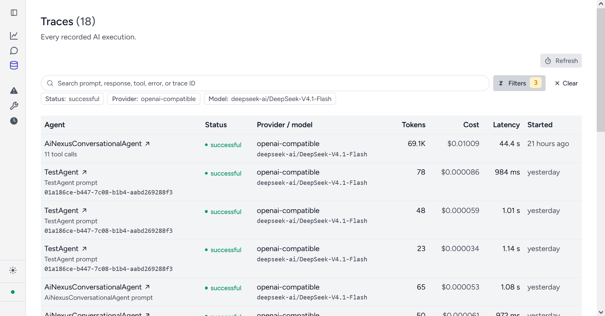
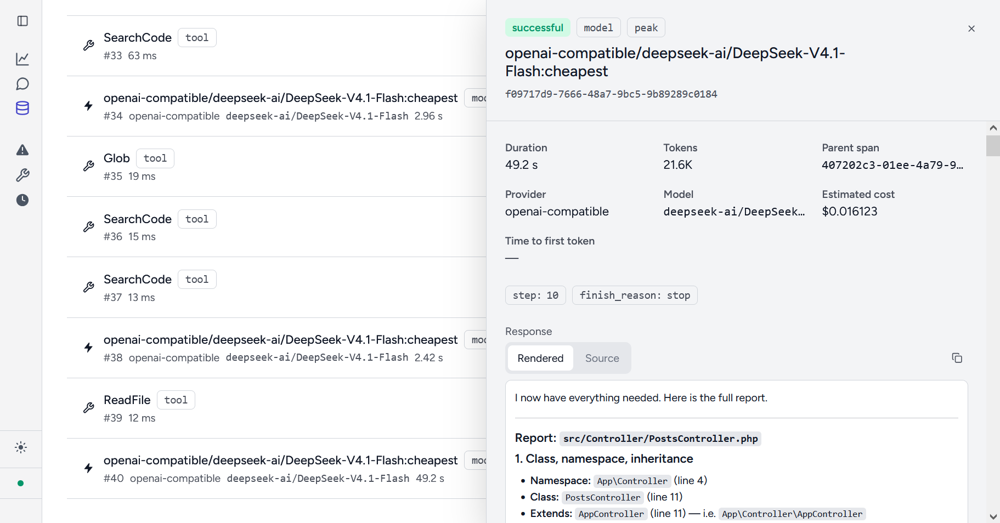

# AiObservability

AiObservability (`crustum/ai-observability`, `Crustum\AiObservability`) records and displays the AI operations performed by applications using the `crustum/ai` plugin. It listens to supported SDK events and builds a trace of each agent run — model steps, tool calls, streaming lifecycle, token usage, latency, errors, and provider failover — plus standalone embedding, reranking, image, audio, and transcription operations. A Vue dashboard renders the overview, trace timelines, and conversation views.



It is not an AI framework: no agents, prompts, tools, or model routing — keep using `crustum/ai` directly for all of that. It records only provider-visible data the SDK exposes, never hidden model reasoning, and recorder failures are isolated so a persistence problem can never interrupt or replace an AI response.

> Prompts, responses, tool arguments, and tool results may contain credentials and personal data. Review capture controls, redaction, authorization, and retention before enabling recording outside a local environment.




## Requirements

- PHP >= 8.4
- CakePHP ^5.4
- `crustum/cakephp-ai` >= 2.0
- `cakephp/migrations` >= 4.0 (SQLite, MySQL, and PostgreSQL supported)

Sync recording needs no queue infrastructure. Queue mode needs a configured CakePHP Queue connection with an active worker. The compiled dashboard bundle ships with the package — no Node toolchain required.

## Installation

```bash
composer require crustum/ai-observability
bin/cake plugin load Crustum/AiObservability
```

Loading the plugin registers its console commands, services, and SDK event wiring. Recording itself stays gated by configuration — loading alone persists nothing. It is enabled when `AiObservability.enabled` is `true`, which follows the application debug flag by default, so local environments record without further setup. Elsewhere, enable it explicitly:

```bash
AI_OBSERVABILITY_ENABLED=true
```

Publish the configuration (also copies migrations and the dashboard bundle into the application, and never overwrites your customized files on re-run):

```bash
bin/cake manifest install --plugin Crustum/AiObservability
bin/cake migrations migrate
```

This creates the `ai_observatory_traces`, `ai_observatory_spans`, and `ai_observatory_events` tables. Verify everything with the status command, which covers enablement, migrations, SDK compatibility, recording mode, queue, retention, recovery, dashboard path, and authorization:

```bash
bin/cake ai observability status
```

Then visit `/ai-observability` locally. The root redirects to the overview, traces live under `/traces`, conversations under `/conversations`, and the JSON API under `/api`.

## Recording your first trace

No facade or custom agent base class is needed — prompt exactly as today and the plugin records around the call:

```php
$response = (new SupportAgent)->prompt('Summarize the latest customer message.');
```

Open `/ai-observability/traces` to see one trace for the invocation: root agent span, model steps, tool spans, and instant events for failover, approval, and streaming milestones. Terminal failures close the trace immediately with error type and message. Some failures never dispatch a completion event (disconnect mid-stream, killed process) and the trace stays `running` — mark abandoned runs `cancelled` (never `failed`, preserving the distinction) with:

```bash
bin/cake ai observability recover-stale
bin/cake ai observability recover-stale --minutes 30 --chunk 500
```

## Application context and users

Attach searchable business context around any call. It is captured at trace start and flows through the same redaction and size limits as every stored payload:

```php
use Crustum\AiObservability\Service\AiObservabilityService;

$service = $container->get(AiObservabilityService::class);

$response = $service->withContext([
    'feature' => 'ticket-reply',
    'ticket_id' => $ticket->getKey(),
], fn () => (new SupportAgent)->prompt($message));
```

The previous context is restored afterwards, even on throw, so attributes never leak into unrelated operations. Direct helpers (`$service->tag('ticket_id', ...)`, `$service->feature('ticket-reply')`) set values before the call — context added after the trace starts does not attach retroactively. There is no tenant concept: user and feature values carry the searchable identity.

| User source | Result |
|---|---|
| Explicit `user` key in context | Wins over everything; entities contribute primary key plus table source as type |
| Request identity | Resolved without any auth package; unknown shapes resolve to null, never fail recording |
| Console / workers | No user, unless explicit context is set around the operation |

## Traces, spans, and events

A trace is one complete workflow with status `running`, `successful`, `failed`, or `cancelled`. A span is a timed operation within it (agent, model, tool), with its own timing, provider and model metadata, payloads, usage, cost, and error fields. An event is an instant occurrence — failover, approval, streaming milestones — attached to a trace, a span, or both, so milestones render without storing every streamed token.

Model spans take usage from the individual step, never re-added from the aggregate response, so multi-step runs never double-count. Step requests store the step number rather than a second copy of history, and reasoning text is not recorded. Streaming is aggregated from the completed response (start, first-token time, completion, final text, finish reason, usage) rather than one record per token. Usage normalizes into nullable input, output, cached-input, cache-write, reasoning, and total categories — missing measurements stay null, never zero. Costs compute only when the pricing catalog holds every rate the reported usage needs; unknown or mixed-currency pricing yields null, and unpriced usage is never shown as free.

## Recording modes

```bash
AI_OBSERVABILITY_RECORDING_MODE=sync
```

| Mode | Behavior |
|---|---|
| `sync` | Persists each event during the operation. Local default, no queue needed. |
| `after_response` | Buffers redacted, size-limited events and persists after the response completes. No queue needed. |
| `queue` | Dispatches one compressed job of serialized internal event arrays (`AI_OBSERVABILITY_QUEUE_CONNECTION`, `AI_OBSERVABILITY_QUEUE=observatory`). Never queues SDK event objects; oversized batches fall back to local persistence. |

If queue mode records nothing, confirm a worker consumes the configured queue, then temporarily switch to sync with `AI_OBSERVABILITY_DEBUG=true` to separate dispatch from persistence problems.

New SDK event families are covered by registering an adapter (`$service->registerEventAdapter(...)`) implementing the `AiSdkEventAdapter` contract. Unknown events are ignored safely.

## Sampling

```bash
AI_OBSERVABILITY_SAMPLE_RATE=1.0
AI_OBSERVABILITY_ALWAYS_RECORD_FAILURES=true
AI_OBSERVABILITY_ALWAYS_RECORD_SLOW_TRACES_MS=10000
AI_OBSERVABILITY_MAX_BUFFERED_EVENTS=100
```

`1.0` records everything, `0.1` deterministically keeps roughly ten percent, `0.0` keeps none unless promoted. The decision is made once from the trace id so sampled traces stay complete. Unsampled traces buffer their (already redacted, size-limited) events and persist on failure/cancellation or when duration crosses the slow threshold; with both promotions off, unsampled events are discarded unbuffered. Promotion is evaluated at finish, so an interrupted unsampled trace that never completes cannot be promoted.

## Capture, redaction, and size limits

```php
'capture' => [
    'prompts' => true,
    'responses' => true,
    'tool_arguments' => true,
    'tool_results' => true,
    'embeddings' => false,   // raw vectors are never stored
    'stack_traces' => false, // off by default
],
```

Disabled categories are removed before persistence — the trace keeps timing, status, provider, model, and usage, minus the content. Redaction runs before sync, deferred, or queued persistence, recursively and case-insensitively, over metadata, tags, payloads, and error fields:

```php
'redaction' => [
    'replacement' => '[REDACTED]',
    'keys' => ['authorization', 'api_key', 'password', 'customer_secret'],
    'paths' => ['request.headers.authorization', 'request.tools.*.arguments.password'],
],
```

Replacing `keys` replaces the defaults — retain every default still needed. Paths support one `*` wildcard segment. For logic keys and paths cannot express, register a callback at boot (`$service->redactUsing(...)`), which runs after the built-in rules. Each payload is then bounded (`'payloads' => ['max_bytes' => 100_000]`); oversized content becomes a truncation marker with the original byte count, irreversibly.

## Pricing catalog

The plugin never downloads pricing. Define per-million-token estimates with a three-letter currency; catalog version and effective date are stored with every amount so figures stay traceable:

```php
'pricing' => [
    '_meta' => ['version' => 'internal-2026-07', 'effective_date' => '2026-07-01'],
    'provider-name' => [
        'model-name' => [
            'input_per_million' => 10,
            'output_per_million' => 30,
            'cached_input_per_million' => 1,
            'cache_write_input_per_million' => 12.5,
            'currency' => 'USD',
        ],
    ],
],
```

Keys must match the normalized span values. Optional `peak` windows apply alternate rates during provider peak hours (ISO-8601 days, windows may span midnight), falling back to base rates per unset rate, with the matched tier recorded in span metadata.

## Dashboard

The overview summarizes traces since the start of the current day: count and failure rate, tokens, cost (single currency only), average and P95 duration, top agents, providers, models, tools, and recent failures. The trace list is the main debugging view — status, agent, provider, model, tools, tokens, cost, duration, user, feature — with free-text search (wildcards escaped) and filters for status, provider, model, agent, span type, feature, user, conversation, errors, tool presence, duration, and dates. Trace detail pairs the summary with the parent-child span timeline in sequence order; payloads pass redaction and size limits again before rendering, masked values stay marked, and truncated payloads show markers.

Conversations group traces into chats by conversation id: one row per chat with turns, tokens, cost, user, and last activity; detail renders turns oldest-first as prompt plus Markdown reply, with step chips, tool calls, and links into the underlying traces. Light, dark, and system themes ship in the sidebar switcher. The sidebar splits Observe (overview, conversations, traces) from Reports (failures, tool calls, slow traces as preset filtered views). The JSON API under `/api` serves the same envelopes with pagination metadata, so custom monitors can build on it.

Authentication lives entirely in the host application — add your middleware to `Application::middleware()` and it protects dashboard and API paths with no plugin configuration. Optionally add an authorization callback at boot:

```php
$service->authorizeUsing(function (ServerRequestInterface $request): bool {
    return true; // your policy here
});
```

Without a callback, all authenticated requests are allowed. Never expose the dashboard beyond a local machine without host authentication; the status command reports the active authorization mode.

## Queue context propagation

Jobs performing AI work inherit dispatch-time context via `PropagateAiTraceContextMiddleware` (a Crustum Queue middleware — the host queue must run a processor with the middleware pipeline). The plugin mutates every dispatched payload to carry the snapshot automatically; the middleware restores it before the job runs and restores the worker scope afterwards:

```php
final class SummarizeTicketJob extends MiddlewareJob
{
    public function middleware(Message $message): array
    {
        return [new PropagateAiTraceContextMiddleware()];
    }
}
```

Values are normalized, redacted, and size-limited before entering the payload; unserializable values are omitted while trace correlation survives. Queue recording mode does not add this to application jobs — always add the middleware where propagation is needed. In workers, keep context inside `withContext()` around the work rather than setting it once at boot, or values leak across jobs.

## Configuration reference

The published `config/ai_observability.php` documents every option and is the source of truth (`Configure::read('AiObservability.*')`). The commonly changed environment overrides:

```bash
AI_OBSERVABILITY_ENABLED=true
AI_OBSERVABILITY_DEBUG=false
AI_OBSERVABILITY_PATH=ai-observability
AI_OBSERVABILITY_RECORDING_MODE=sync
AI_OBSERVABILITY_QUEUE_CONNECTION=
AI_OBSERVABILITY_QUEUE=observatory
AI_OBSERVABILITY_SAMPLE_RATE=1.0
AI_OBSERVABILITY_RETENTION_DAYS=14
AI_OBSERVABILITY_STALE_AFTER_MINUTES=15
```

Isolate storage with a dedicated connection before migrating (`'AiObservability' => ['connection' => ...]`); every table, query, and maintenance command follows it.

## Console commands

```bash
bin/cake ai observability status                                    # full health report
bin/cake ai observability prune --days 30 --chunk 500               # delete expired traces, bounded transactions
bin/cake ai observability clear --force --chunk 500                 # wipe all traces (confirmation unless --force)
bin/cake ai observability recover-stale --minutes 30 --chunk 500    # cancel abandoned runs
```

Pruning and recovery are built for a schedule — one pruning pass daily, one recovery pass every quarter hour (raise recovery frequency under heavy streaming load). `clear` never belongs on a schedule.

## Production checklist

Enable explicitly; confirm host authentication plus the authorization callback with unauthorized requests rejected. Disable unneeded capture categories, add application redaction keys and paths, test rules against realistic nested payloads, and size the payload ceiling to the data classification. Consider a dedicated connection, deferred or queued persistence when sync latency is unacceptable, and verify the worker and queue name. Schedule pruning and recovery, watch database growth and queue failures, keep debug logging off unless diagnosing, and re-run status after deployments and SDK upgrades.

## Troubleshooting

No traces: confirm enablement, supported SDK version, migrations, reachable database — start from status output — and that the operation used an event family the active adapter covers. Streaming trace stuck `running`: interrupted connection, resolve with scheduled stale recovery. Payloads masked or truncated: inspect redaction keys/paths, capture switches, and the payload ceiling (truncation is irreversible). Costs unknown: pricing entry missing, incomplete, or conflicting currency. Dashboard forbidden: host authentication or callback for that environment. Migration errors: install through the manifest and run the host migrate command without renaming published files — ordered prefixes keep parents ahead of dependents.

## Upgrading

```bash
composer update crustum/ai-observability
bin/cake manifest install --plugin Crustum/AiObservability
bin/cake migrations migrate
bin/cake ai observability status
```

The manifest never overwrites customized configuration or duplicates migrations. Compare published config against new package defaults when settings arrive, check the status-reported SDK version plus active adapter after every SDK upgrade, and restart queue workers so they pick up the new code.

## Next steps

- [Agents](/agents/) — the runs being recorded
- [MCP](/mcp/) — MCP tool calls in the trace timeline
