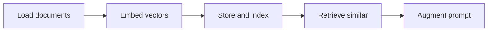

# RAG

Retrieval-augmented generation grounds the model in your data: load
documents, embed them, pull back the similar ones at prompt time, and
feed them in as context. Three stages (process, retrieve, augment) and this plugin owns the seams between them.

## The pipeline



Process (load + embed) is [Loading](./loader.md) and
[Embedding](./embeddings.md); storage is [Stores](./store.md);
retrieve is [Retrieval](./retrieval.md); augment is just prompting
with the winners attached.

## The loop, offline

Embed three passages and a query, rank by cosine similarity, take the
best: the whole retrieval idea with no provider involved beyond vectors:

```php
use Crustum\Ai\Embeddings;

function cosine(array $a, array $b): float
{
    $dot = 0.0;
    $na = 0.0;
    $nb = 0.0;
    foreach ($a as $i => $value) {
        $dot += $value * $b[$i];
        $na += $value * $value;
        $nb += $b[$i] * $b[$i];
    }

    return $dot / (sqrt($na) * sqrt($nb));
}

$passages = [
    'Napa Valley has great wine.',
    'CakePHP is a PHP framework.',
    'The Eiffel Tower is in Paris.',
];

$vectors = Embeddings::for($passages)->generate()->embeddings;
$query = Embeddings::for(['CakePHP framework'])->generate()->first();

$best = 0;
$bestScore = -2.0;
foreach ($vectors as $index => $vector) {
    $score = cosine($vector, $query);
    if ($score > $bestScore) {
        $best = $index;
        $bestScore = $score;
    }
}

echo $passages[$best] . PHP_EOL;
```

```text [Output]
CakePHP is a PHP framework.
```

## Three ways to retrieve

- **Application tables**: vectors in your own columns, `similarTo`
finder, `SimilaritySearch` tool. Your SQL, your data, no uploads.
- **Provider stores**: files uploaded once, searched provider-side with
`FileSearch`. No vectors in your schema.
- **Search engine**: Explorator with semantic/hybrid search over your
models. Full-text and vectors fused.

The comparison lives under [Retrieval](./retrieval.md); the storage side
under [Stores](./store.md).

## See also

- [Loading](./loader.md) — files in
- [Embedding](./embeddings.md) — vectors out
- [Stores](./store.md) — where documents wait
- [Retrieval](./retrieval.md) — getting them back
